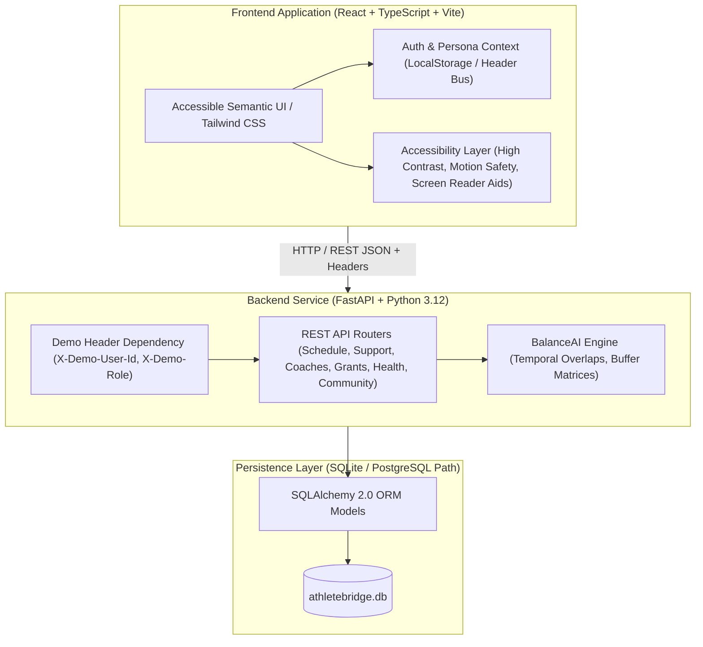

# ATHLETEBRIDGE — Architecture & Systems Specification
## Inclusive Athlete Development Platform

> **Tagline**: *"One platform for every athlete. Personalized support for every ability."*

---

## 1. System Overview

AthleteBridge is designed to dismantle silos between able-bodied and adaptive athletics while harmonizing the demanding collision of university coursework and varsity sport. Rather than segregating student-athletes into separate niche apps, AthleteBridge provides a single unified architecture with customizable accessibility layers, private accommodation workflows, and transparent scheduling optimization.

---

## 2. Core Architecture Principles

1. **One Shared Platform**: Built on universal design. Accommodations and accessibility preferences are additive options, not segregated experiences.
2. **Confidentiality by Default**: Sensitive disability accommodations, proctoring letters, mental health reflections, and private equipment notes are strictly gated in the data model and never broadcasted to peers or public feeds.
3. **Transparent Algorithmics**: BalanceAI provides readable explanations for why two events conflict (e.g. transit buffer violations) and why a candidate reschedule slot was suggested.
4. **Non-Diagnostic Boundaries**: FuelRight, MindStrong, and TrainingRecovery strictly present self-reported metrics and educational guidance without claiming medical diagnosis or therapy.
5. **Conspicuous Fictional Seed Telemetry**: All demo coaches, scholarships, and opportunities are prominently tagged (`[DEMO LISTING]`, `[DEMO DATA]`) to prevent deception.

---

## 3. Data Model & Relationships

The relational schema is normalized and enforced using SQLAlchemy 2.0:

- **Identity & Context**:
  - `users`: Core account record with role (`athlete`, `staff`, `coach`, `counsellor`).
  - `athlete_profiles`: Public and institutional dual-career background (major, sports, skill level, training windows).
  - `athlete_support_preferences`: Confidential accommodation preferences, communication channels, and equipment notes (`is_private=True`).

- **BalanceAI Commitments**:
  - `events`: Commitments with `date`, `start_time`, `end_time`, `event_type`, `is_fixed`, `buffer_minutes`, and `location`.

- **AccessMatch & Coaching**:
  - `coaches`: Verified demo listings with stated accessibility specialties, fees, and contact details.
  - `coach_requests`: Inquiries for consultations logged by athletes.
  - `opportunities`: Camps, showcases, and invitationals with verified venue accessibility metadata (`Verified Accessible Venue` vs `Unverified Access Details`).
  - `saved_opportunities`: Bookmarks and demo registrations.

- **Scholarships & Grants**:
  - `scholarships`: Dual-career grants with eligibility criteria, deadlines, and application checklists.
  - `saved_scholarships`: Athlete application tracker (`saved` -> `preparing` -> `submitted`).

- **SupportBridge Accommodations**:
  - `support_requests`: Accommodation tickets with categories (`academic_exam`, `training_facility`, `travel_competition`, `assistive_tech`).
  - `support_request_history`: Immutable decision audit trail logging each status transition (`submitted` -> `under_review` -> `approved` / `declined` -> `resolved`) with staff notes.

- **DualProgress & Wellbeing**:
  - `progress_goals`: Independent academic goals vs sports goals.
  - `athlete_achievements`: Milestones with provenance tracking (`verified_institutional` vs `self_entered`) and privacy controls.
  - `meal_logs`, `training_sessions`, `recovery_logs`: Self-reported habit logs.
  - `counsellors`, `counsellor_bookings`, `mood_entries`: Non-clinical sports psychology resources and private reflections.
  - `community_groups`, `group_posts`, `user_blocks_reports`: Moderated peer camaraderie with zero tolerance for harassment.

---

## 4. BalanceAI Scheduling Algorithm

The conflict and rescheduling engine in [`scheduling.py`](file:///C:/Users/Hp/.gemini/antigravity/scratch/athletebridge/backend/app/scheduling.py) evaluates temporal integrity in polynomial time:

1. **Conflict Detection**:
   - For all pairs $(E_A, E_B)$ on date $D$:
     - **Direct Overlap**: $\max(start_A, start_B) < \min(end_A, end_B)$ $\implies$ Critical Overlap.
     - **Buffer Violation**: If $end_A \le start_B$ but $(start_B - end_A) < \max(buffer_A, buffer_B)$ $\implies$ Transition Warning.
2. **Alternative Slot Generation**:
   - Flexible commitments are evaluated across candidate dates on 30-minute intervals between 07:00 and 21:30.
   - Any slot overlapping fixed commitments (e.g. exams) or violating buffer boundaries is eliminated.
   - Candidates are scored dynamically:
     - Disruption minimization (+10 for preserving scheduled day, -5 per day shift).
     - Collegiate athletic energy bonus (+15 for morning 07:30-09:30 or afternoon 16:30-18:30 windows).
     - Buffer stability bonus (+5 for ample rest cushion).
   - If no feasible window exists, the engine returns an explicit explanation without fabricating impossible slots.

---

## 5. Security, Authorization & Privacy Boundaries

- **Role Gating**:
  - Endpoints under `/api/support/staff-queue` and `/api/staff/*` enforce `require_staff_role`.
  - Regular athletes receive HTTP 403 Forbidden if attempting to inspect the institutional queue.
  - Private reflections (`/api/mindstrong/moods`) are filtered strictly by `athlete_id == current_user.id` and are permanently deletable.
- **Data Protection**:
  - Passwords and sensitive medical diagnoses are not accepted or stored.
  - All synthetic records are generated locally in SQLite (`athletebridge.db`).
- **Production Hardening Path**:
  - Transition from header-based demo context to signed JWT tokens via OAuth2 / OIDC institutional SSO.
  - Migrate SQLite to managed PostgreSQL with row-level security (RLS).
  - Implement Redis token-bucket rate limiting on public endpoints.
